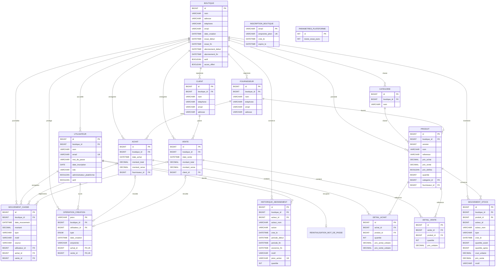

# Schema de Base de Donnees

Ce schema est reconstruit a partir des entites JPA du projet Spring Boot (`3.5.16`) et de la strategie de nommage par defaut en `snake_case`.

Base cible : `stock_pro`

## Création d'une base neuve

Le fichier [database-schema.sql](database-schema.sql) crée les dix-sept tables du schéma actuel, dont `boutique`, le stockage des liens de réinitialisation et des inscriptions publiques, le journal des abonnements et celui de l’inventaire. Il conserve les règles métier existantes et rend les noms de catégories uniques par boutique.

Exécuter ce fichier uniquement pour initialiser une base neuve, puis lancer `./gradlew initialAdmin` : cette commande crée la boutique principale si elle est absente et y rattache le premier administrateur de boutique. Le script SQL ne crée aucun compte ni ne stocke de mot de passe. Le droit d'administration de la plateforme reste désactivé par défaut ; il est attribué séparément à un compte ADMIN existant par la [migration des accès plateforme](migrations/plateforme.md).

L'application utilise par défaut `ddl-auto=validate` : elle vérifie le schéma au démarrage sans créer ni modifier les tables. Pour une base contenant déjà des données, suivre la [migration des boutiques](migrations/boutiques.md) après arrêt de l'application et sauvegarde complète. Les `CREATE TABLE IF NOT EXISTS` du fichier de création ne convertissent pas des tables existantes ; ne pas les employer comme migration.

## Tables

### `mouvement_stock`

Journal des stocks initiaux et corrections d’inventaire : `id` BIGINT auto-incrémenté ; `boutique_id`, `produit_id` BIGINT avec clés étrangères sans cascade ; `acteur_id` BIGINT et `acteur_nom` VARCHAR(255) figés ; `type` VARCHAR(16) (`INITIAL` ou `AJUSTEMENT`) ; `cree_le` DATETIME(6) UTC ; `quantite_avant`, `quantite_apres` BIGINT non négatifs ; `cout_unitaire` DECIMAL(17,2) facultatif (présent pour le stock initial) ; `prix_vente` DECIMAL(17,2) facultatif (tarif choisi pour un nouveau stock initial, `NULL` pour les historiques antérieurs et les ajustements) ; `motif` VARCHAR(500) obligatoire. Index `(boutique_id, produit_id, cree_le, id)` pour l’historique paginé. Les comptes peuvent être supprimés sans effacer leur nom historique ; un produit avec historique est conservé.

Les fiches produit démarrent à zéro, sans prix à saisir. L’achat ou le stock initial définit le coût d’achat et le prix de vente. Une fiche sans tarifs permet de modifier uniquement ses informations du catalogue ; une fois les tarifs définis, le prix de vente peut aussi être modifié depuis la fiche. Un produit sans tarifs a `prix_definis=FALSE` et ses deux prix techniques ainsi que sa quantité à zéro. L’interface affiche « À définir » et ce produit ne peut pas être vendu. La [migration d’inventaire](migrations/inventaire.md) ajoute le journal ; la [migration des tarifs](migrations/tarification.md) ajoute le statut et les deux prix de vente historiques sans changer les données précédentes.

Le solde initial de caisse utilise `mouvement_caisse`, avec `source=SOLDE_INITIAL` et `type=OUVERTURE`. Il ne nécessite aucune nouvelle colonne, contribue au solde à l’ouverture et au solde total, et reste exclu des recettes et variations opérationnelles du jour.

### `boutique`
- `id` PK
- `nom` VARCHAR(255) NOT NULL
- `adresse` VARCHAR(500) NULL : adresse commerciale facultative
- `telephone` VARCHAR(50) NULL : téléphone commercial facultatif
- `email` VARCHAR(254) NULL : email commercial facultatif, indépendant des emails de connexion
- `date_creation` DATETIME(6) NOT NULL
- `essai_debut`, `essai_fin` DATETIME(6) NULL : bornes UTC persistées de l'essai ; toutes deux vides pour les boutiques historiques
- `abonnement_debut`, `abonnement_fin` DATETIME(6) NULL : bornes UTC de la période activée manuellement ; toutes deux vides avant une première activation
- `actif` BOOLEAN NOT NULL DEFAULT TRUE : ouverture ou suspension de la boutique
- `acces_offert` BOOLEAN NOT NULL DEFAULT FALSE : mode commercial offert, indépendant des rôles

Les neuf tables racines (`utilisateur`, `categorie`, `client`, `fournisseur`,
`produit`, `achat`, `vente`, `mouvement_caisse`, `operation_creation`) portent
`boutique_id` BIGINT NOT NULL, avec une clé étrangère vers `boutique.id`. Les
lignes d’achat et de vente appartiennent à la boutique de leur document ;
leurs produits doivent appartenir au même espace. Les accès métier déterminent
la boutique depuis le compte authentifié, sans utiliser un identifiant fourni
par le navigateur. Voir [migration des boutiques](migrations/boutiques.md).

### `categorie`
- `id` PK
- `nom` : UNIQUE (`boutique_id`, `nom`)

### `client`
- `id` PK
- `nom`
- `telephone`
- `email`
- `adresse`

### `fournisseur`
- `id` PK
- `nom`
- `telephone`
- `email`
- `adresse`

### `utilisateur`
- `id` PK
- `nom`
- `email` VARCHAR(255) NOT NULL UNIQUE : enregistré sans espaces autour et en minuscules
- `mot_de_passe`
- `date_inscription`
- `role` valeurs attendues : `CAISSIER`, `ADMIN`
- `administrateur_plateforme` BOOLEAN NOT NULL DEFAULT FALSE : droit distinct de la gestion d'une boutique ; réservé à un compte ADMIN désigné explicitement
- `actif` BOOLEAN NOT NULL DEFAULT TRUE : autorisation individuelle de connexion ; sa désactivation conserve le compte, les droits et les historiques

### `reinitialisation_mot_de_passe`

- `utilisateur_id` BIGINT PK/FK -> `utilisateur.id` : au maximum un lien courant par compte
- `empreinte_jeton` VARCHAR(64) NOT NULL UNIQUE : SHA-256 du jeton, jamais le jeton utilisable
- `empreinte_mot_de_passe` VARCHAR(64) NOT NULL : empreinte du hash BCrypt lors de l'émission
- `cree_le`, `expire_le` DATETIME(6) NOT NULL : dates UTC, validité de 30 minutes par défaut

Le lien est remplacé à chaque nouvelle émission et supprimé dans la même
transaction que le changement de mot de passe lors de son utilisation. Un
changement depuis Mon compte invalide aussi les liens précédemment émis. La
[migration dédiée](migrations/reinitialisation-mdp.md) ajoute uniquement cette
table vide ; elle conserve les douze tables et les comptes existants.

### `inscription_boutique`

- `email` VARCHAR(254) PK : email valide et normalisé de la demande
- `empreinte_jeton` VARCHAR(64) NOT NULL UNIQUE : SHA-256 du lien de confirmation, jamais le lien utilisable
- `cree_le`, `expire_le` DATETIME(6) NOT NULL : dates UTC de la demande et de sa limite

Cette demande est indépendante des comptes et des liens de récupération. Elle
ne contient aucun mot de passe et aucune clé étrangère vers une boutique.
L'utilisation du lien crée la boutique et son gérant dans une seule transaction,
puis supprime la demande. Un email de compte existant ne devient pas un nouvel
espace et n'acquiert aucun droit supplémentaire.

### `parametres_plateforme`

- `id` INTEGER PK : valeur unique applicative `1`, sans auto-incrément
- `duree_essai_jours` INTEGER NOT NULL : durée des nouveaux essais, de 1 à 3650 jours

La ligne est facultative. Tant qu'aucun réglage n'est enregistré, la configuration
`stock.trial.days` fournit la durée, 30 jours par défaut. La date de fin est fixée
lors de la création effective de chaque boutique : modifier la durée globale ne
change aucun essai déjà commencé. Les boutiques historiques gardent leurs dates
d'essai vides ; aucun délai n'est ajouté automatiquement. `acces_offert` reste
distinct de la suspension manuelle et de l'essai. Voir la
[migration inscription et essai](migrations/inscription-essai.md).

### `historique_abonnement`

- `id` BIGINT PK, auto-incrémenté
- `boutique_id` BIGINT NOT NULL FK -> `boutique.id` : espace concerné
- `acteur_id` BIGINT NOT NULL FK -> `utilisateur.id` : auteur de la décision de plateforme, éventuellement rattaché à une autre boutique
- `acteur_nom` VARCHAR(255) NOT NULL : nom enregistré lors de l'action
- `action` VARCHAR(32) NOT NULL : `PROLONGATION_ESSAI`, `ACTIVATION_ABONNEMENT`, `ACCES_OFFERT`, `RETRAIT_ACCES_OFFERT`, `SUSPENSION_BOUTIQUE` ou `REACTIVATION_BOUTIQUE`
- `cree_le` DATETIME(6) NOT NULL : instant UTC de la décision
- `periode_debut`, `periode_fin`, `ancienne_fin` DATETIME(6) NULL : période accordée et ancienne échéance pour une prolongation ou activation
- `motif` VARCHAR(500) NULL : justification facultative
- `jeton_action` VARCHAR(36) NOT NULL UNIQUE : UUID du formulaire pour reconnaître un renvoi
- `quantite` INTEGER NULL : jours ajoutés à l'essai ou un mois d'abonnement
- index non unique `idx_historique_abonnement_boutique_date` sur `(boutique_id, cree_le, id)` pour la pagination

Les décisions et les dates de boutique sont enregistrées dans la même
transaction. Le journal est consultable par boutique ; les anciennes données
ne sont pas transformées en événements. Les références sont conservées sans
suppression en cascade. L'accès offert et la suspension restent indépendants
des périodes. Voir la [migration des abonnements](migrations/abonnement.md).

### `produit`
- `id` PK
- `version` BIGINT NOT NULL DEFAULT 0 : version JPA pour détecter les modifications concurrentes
- `nom`
- `reference`
- `prix_achat`
- `prix_vente`
- `prix_definis` BOOLEAN NOT NULL DEFAULT TRUE : distingue un produit dont les tarifs sont définis, y compris à zéro, d’une nouvelle fiche en attente d’achat ou de stock initial ; le service de création fixe explicitement `FALSE`
- `quantite`
- `categorie_id` FK -> `categorie.id`
- `fournisseur_id` FK -> `fournisseur.id`

### `achat`
- `id` PK
- `date_achat`
- `montant_total`
- `montant_verse`
- `fournisseur_id` FK -> `fournisseur.id`

### `detail_achat`
- `id` PK
- `achat_id` FK -> `achat.id`
- `produit_id` FK -> `produit.id`
- `quantite`
- `prix_achat_unitaire`
- `prix_vente_unitaire` DECIMAL(17,2) NULL : prix de vente choisi lors de cet achat ; les lignes antérieures conservent `NULL`, aucun prix actuel du produit n’est recopié dans une ancienne facture

### `vente`
- `id` PK
- `date_vente`
- `montant_total`
- `montant_verse`
- `client_id` FK -> `client.id`

### `detail_vente`
- `id` PK
- `vente_id` FK -> `vente.id`
- `produit_id` FK -> `produit.id`
- `quantite`
- `prix_unitaire`

### `mouvement_caisse`
- `id` PK
- `date_mouvement`
- `montant`
- `type`
- `motif`
- `source`
- `utilisateur_id` FK -> `utilisateur.id`
- `achat_id` FK optionnelle -> `achat.id`, pour les versements fournisseurs
- `vente_id` FK optionnelle -> `vente.id`, pour les versements clients

### `operation_creation`

- `jeton` VARCHAR(36) PK : identifiant aléatoire du formulaire
- `utilisateur_id` FK NOT NULL -> `utilisateur.id` : propriétaire du formulaire
- `type` : `ACHAT` ou `VENTE`
- `date_creation` : instant UTC d'ouverture ; validité de 24 h avant utilisation
- `empreinte` VARCHAR(64), renseignée au succès : empreinte des saisies initiales
- `achat_id` FK optionnelle UNIQUE -> `achat.id`
- `vente_id` FK optionnelle UNIQUE -> `vente.id`

Un résultat est enregistré dans la même transaction que le stock, le document et la caisse. Les résultats utilisés sont conservés pour reconnaître les renvois ultérieurs.

## Diagramme relationnel



## Source des tables

- `Achat.java`
- `Boutique.java`
- `Categorie.java`
- `Client.java`
- `DetailAchat.java`
- `DetailVente.java`
- `Fournisseur.java`
- `MouvementCaisse.java`
- `OperationCreation.java`
- `Produit.java`
- `Utilisateur.java`
- `Vente.java`
- `ReinitialisationMotDePasse.java`
- `InscriptionBoutique.java`
- `ParametresPlateforme.java`
- `HistoriqueAbonnement.java`
- `MouvementStock.java`

## Remarques

- Les proprietes calculees comme `getResteAPayer()` ne creent pas de colonne en base.
- Les annotations de validation comme `@NotBlank` et `@Email` expriment surtout des regles applicatives; elles ne sont pas toutes materialisees en contraintes SQL dans ce script.
- Les suppressions en cascade JPA ne signifient pas automatiquement `ON DELETE CASCADE` au niveau MySQL, donc ce script reste volontairement proche du mapping JPA.

## Mise à jour d'une base existante : version des produits

Le mapping `@Version` nécessite la colonne `produit.version`. Avec `spring.jpa.hibernate.ddl-auto=update`, Hibernate demande son ajout au prochain démarrage. Le défaut SQL `0` initialise les produits existants sans changer leur quantité.

Si le schéma est administré manuellement (`ddl-auto=none` ou `validate`), ajouter la colonne une seule fois, si elle est absente :

```sql
ALTER TABLE produit ADD COLUMN version BIGINT NOT NULL DEFAULT 0;
```

Le script `database-schema.sql` décrit les nouvelles bases ; son `CREATE TABLE IF NOT EXISTS` ne met pas à jour une table déjà existante. Cette migration MySQL n'a pas été exécutée pendant les tests, qui utilisent H2 en mémoire. Les formulaires de modification de produit ouverts avant la mise à jour doivent être rechargés.

## Mise à jour d'une base existante : règlements fournisseurs

Le lien optionnel `mouvement_caisse.achat_id` associe les nouveaux versements et les versements initiaux des nouveaux achats à leur facture. Avec `ddl-auto=update`, Hibernate demande l'ajout de cette colonne et de sa clé étrangère au prochain démarrage.

Pour un schéma administré manuellement, ajouter une seule fois la colonne et sa contrainte si elles sont absentes :

```sql
ALTER TABLE mouvement_caisse
    ADD COLUMN achat_id BIGINT NULL,
    ADD CONSTRAINT fk_mouvement_caisse_achat
        FOREIGN KEY (achat_id) REFERENCES achat (id);
```

Les anciens mouvements restent conservés avec `achat_id = NULL` ; aucune association n'est déduite de leur texte de motif. Le montant déjà payé des achats existants reste la référence pour leur dette. Leur historique de versements antérieur reste dans le journal général de caisse. Cette migration n'a pas été exécutée sur MySQL pendant les tests.

## Mise à jour d'une base existante : montants décimaux

Les colonnes monétaires utilisent `DECIMAL(17,2)` : prix d'achat et de vente des produits, totaux et versements des achats/ventes, prix unitaires des lignes, montant des mouvements de caisse et tarifs d’inventaire. Les prix techniques des produits restent obligatoires ; `prix_definis` distingue les tarifs réels, même gratuits, des fiches en attente. Les colonnes de versement et les prix de vente historiques antérieurs conservent les anciens `NULL`.

Le script de création ne convertit pas les tables existantes. Avant de démarrer l'application sur une ancienne base, suivre le [guide de migration](montants-et-migration.md), qui décrit l'arrêt des instances, la sauvegarde complète et les scripts avec contrôles et copies des tables. Un `bootRun` déjà lancé avec DevTools et `ddl-auto=update` peut demander cette conversion lors d'un rechargement automatique.

## Mise à jour d'une base existante : règlements clients

Le lien optionnel `mouvement_caisse.vente_id` associe les versements initiaux des nouvelles ventes et les nouveaux règlements à leur facture. Avec `ddl-auto=update`, Hibernate demande l'ajout de la colonne et de la clé étrangère au démarrage ou lors d'un rechargement DevTools.

Pour un schéma administré manuellement, sauvegarder la base puis exécuter une seule fois ce script, si la colonne et sa contrainte sont absentes :

```sql
ALTER TABLE mouvement_caisse
    ADD COLUMN vente_id BIGINT NULL,
    ADD CONSTRAINT fk_mouvement_caisse_vente
        FOREIGN KEY (vente_id) REFERENCES vente (id);
```

Les anciennes lignes conservent `vente_id = NULL` ; aucun rattachement n'est déduit du texte des motifs. Le cumul `vente.montant_verse` reste la référence pour le reste à payer, avec les anciens `NULL` interprétés comme zéro. Le nouveau lien n'autorise pas la suppression d'une vente ayant des mouvements de caisse ; aucun parcours de suppression de vente n'est ajouté. Ne pas réexécuter le script de création complet pour migrer une base existante.

## Mise à jour d'une base existante : comptes utilisateurs

La contrainte `uk_utilisateur_email` empêche deux créations simultanées avec le même email. Les nouveaux comptes et les connexions utilisent la même normalisation Java : `trim()` puis `toLowerCase(Locale.ROOT)`. Un callback JPA applique également cette règle aux écritures d'utilisateurs. Les adresses saisies acceptent au maximum 254 caractères ; la colonne reste `VARCHAR(255)` pour éviter un rétrécissement inutile.

**Arrêter les instances de l'application et DevTools avant de compiler ou migrer une ancienne base**, afin d'éviter qu'un `ddl-auto=update` n'ajoute la contrainte avant le contrôle des données. Voir le [guide des comptes et de migration](comptes-et-migration.md).

```sh
./gradlew accountEmailsCheck
# Après sauvegarde complète et vérification des comptes :
./gradlew accountEmailsMigrate
```

Ces commandes JDBC ne démarrent pas Spring ni le serveur web. Le contrôle est en lecture seule. La migration refuse les adresses invalides et les doublons, y compris les collisions dues à la collation SQL, avant toute écriture. Elle conserve une copie des lignes dans `accounts_backup_20261005_utilisateur`, normalise uniquement les emails puis ajoute la contrainte unique et NOT NULL. Les identifiants, noms, rôles, empreintes et liens de caisse restent identiques. Une copie existante n'est jamais écrasée ; une base conforme est laissée intacte.

## Mise à jour d'une base existante : administration de la plateforme

Après la migration des boutiques, suivre le [guide des accès plateforme](migrations/plateforme.md). Il ajoute les états de boutique et le droit plateforme avec des valeurs par défaut explicites, puis peut attribuer ce droit à un seul compte ADMIN sélectionné par `PLATEFORME_ADMIN_EMAIL`. L'ancien rôle de gérant, les mots de passe et les appartenances aux boutiques sont conservés. Aucun droit plateforme n'est déduit automatiquement du rôle ADMIN.

## Mise à jour d'une base existante : accès individuels des utilisateurs

Après la migration des accès plateforme, suivre le [guide des accès utilisateurs](migrations/acces-utilisateurs.md). Il ajoute `utilisateur.actif BOOLEAN NOT NULL DEFAULT TRUE` pour conserver l'accès de tous les comptes existants. Une colonne déjà conforme n'est pas réinitialisée : les comptes désactivés restent désactivés. Aucun compte, mot de passe, rôle, droit plateforme ni historique n'est supprimé ou modifié.

## Mise à jour d'une base existante : coordonnées des boutiques

Après la migration des accès utilisateurs, suivre le [guide des paramètres boutique](migrations/parametres-boutique.md). Il ajoute les trois coordonnées facultatives de `boutique` : adresse, téléphone et email. Les noms, dates, états, droits et toutes les anciennes colonnes des douze tables restent identiques. Les anciennes boutiques reçoivent des coordonnées `NULL` ; aucune adresse n'est déduite d'un compte ou d'un partenaire. Un schéma déjà conforme conserve les coordonnées saisies lors des relances.

## Mise à jour d'une base existante : inscription publique et essais

Après la migration des liens de réinitialisation, suivre le
[guide inscription et essai](migrations/inscription-essai.md). Il ajoute les deux
dates d'essai facultatives à `boutique` et crée les tables vides des inscriptions
et des paramètres de plateforme. Les treize tables et toutes leurs anciennes
colonnes sont conservées, y compris les mots de passe, comptes désactivés,
coordonnées et demandes de récupération. Les anciennes boutiques gardent leurs
deux dates d'essai `NULL` et leur accès existant. Une relance conserve aussi les
essais déjà commencés, la durée configurée et les inscriptions en attente.

## Mise à jour d'une base existante : périodes et historique des abonnements

Après la migration inscription et essai, suivre le
[guide des abonnements](migrations/abonnement.md). Il ajoute les deux dates
d'abonnement facultatives et le journal vide des décisions de plateforme.
Les quinze tables précédentes gardent leurs anciennes colonnes et données.
Les boutiques historiques conservent leur accès, sans abonnement ni échéance
inventés. Une relance conserve les périodes et événements déjà enregistrés.

## Mise à jour d’une base existante : tarifs à l’entrée des marchandises

Après la migration d’inventaire, suivre le [guide des tarifs](migrations/tarification.md).
Il ajoute uniquement `produit.prix_definis`, `detail_achat.prix_vente_unitaire` et
`mouvement_stock.prix_vente`. Les dix-sept tables et toutes leurs anciennes colonnes
restent identiques. Les produits existants conservent leurs prix et reçoivent le
statut défini, y compris si un prix était zéro. Les anciennes lignes d’achat et
les anciens mouvements ne reçoivent aucun prix de vente déduit du tarif actuel.
Une relance conserve les nouvelles fiches sans tarifs et tous les prix historiques
déjà enregistrés.
